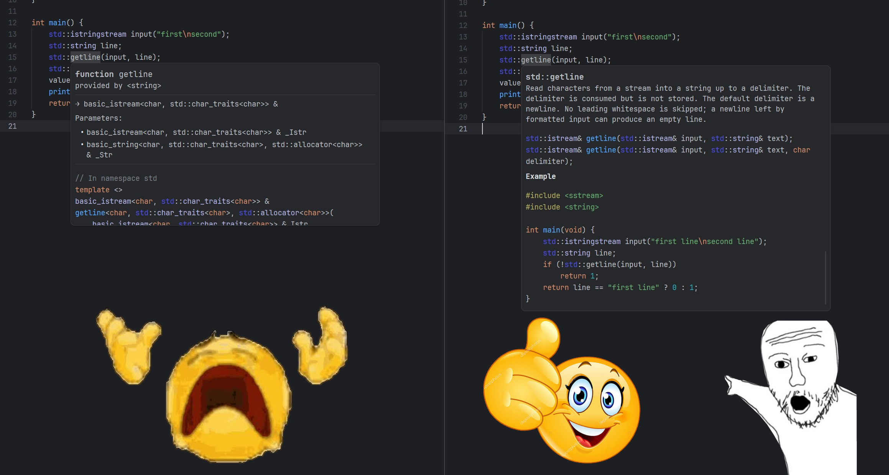

# C/C++ Docs for Zed

Readable cppreference documentation in Zed's C and C++ hover tooltips instead of
raw template declarations.

> **Local documentation.** cppreference is downloaded once on first start and
> stored on your machine. After that, tooltips and full pages work offline.



## How it works

```text
Zed ⇄ zed-cpp-docs-proxy ⇄ clangd
              ↑
      local cppreference
```

The extension starts a small Rust proxy that runs clangd. All requests pass through
unchanged, except hover: when the symbol comes from the standard library, the proxy
replaces the tooltip with a description, signature, parameters and an example. Your
own symbols and ambiguous matches keep the normal clangd tooltip. A link in the
tooltip opens the full page in a browser.

The index has about 11,000 entries from the cppreference HTML book (2025-02-09).
It includes [341 compact descriptions](data/README.md) for everyday C and C++
symbols, with checked examples and per-symbol documentation sources. Other
indexed symbols use the extracted cppreference text.

## Installation

1. Install `clangd` and `curl`, plus [Rust](https://rustup.rs/): Zed needs it to
   build the extension while it is installed from source.
2. Clone the released version:

   ```sh
   git clone --branch v0.3.0 --depth 1 https://github.com/Nazuha26/zed-cpp-docs.git
   ```

   In Zed, open **Extensions → Install Dev Extension** and select the cloned
   `zed-cpp-docs` directory.
3. Add to your Zed settings:

   ```json
   {
     "languages": {
       "C": { "language_servers": ["cpp-docs", "!clangd", "..."] },
       "C++": { "language_servers": ["cpp-docs", "!clangd", "..."] }
     }
   }
   ```

   `!clangd` turns off Zed's built-in clangd, because the proxy starts its own.

On first start, the extension:

1. Downloads the prebuilt proxy from the latest
   [GitHub release](https://github.com/Nazuha26/zed-cpp-docs/releases)
   (Windows and Linux x86_64). If `zed-cpp-docs-proxy` is already in PATH, that
   copy is used instead.
2. Downloads cppreference with `curl` and builds a local index (~350 MB on disk).

For WSL projects, install `clangd` and `curl` inside the distribution.

The current release is [v0.3.0](https://github.com/Nazuha26/zed-cpp-docs/releases/tag/v0.3.0).
Installation currently uses Zed's dev extension support. The release includes
prebuilt proxies for Windows x86_64 and Linux x86_64, plus a compiled WASM launcher
and `SHA256SUMS`. Other platforms require building the proxy from source.

## Settings

Optional, under `lsp.cpp-docs.settings`:

| Setting | Default |
| --- | --- |
| `clangd_path` | `clangd` from PATH |
| `data_dir` | `%LOCALAPPDATA%/zed-cpp-docs` or `~/.local/share/zed-cpp-docs` |
| `descriptions_path` | `%APPDATA%/zed-cpp-docs/descriptions.json` or `~/.config/zed-cpp-docs/descriptions.json` |
| `auto_setup` | `true` — download documentation on first start |

## Custom descriptions

Put your own text for any symbol in `descriptions.json`:

```json
[{ "symbol": "std::vector", "summary": "My short description.", "example": "" }]
```

Fields: `summary`, `signature`, `parameters`, `returns`, `template_parameters`,
`members`, `example`. Missing fields come from the built-in descriptions
([data/compact-docs.json](data/compact-docs.json)) or cppreference; an empty string
hides the section. Restart the language server to apply changes.

## Development

```sh
cargo install --path crates/proxy --locked --force
cargo test --workspace
```

When this repository is open in Zed, run **task: spawn** from the command palette
and choose **C/C++ Docs: build/install proxy (current environment)**. The task in
[.zed/tasks.json](.zed/tasks.json) installs the Windows proxy in a local Windows
project or the Linux proxy in a WSL/Linux project. Restart the language server
after a successful build with **editor: restart language server**.

Build the proxy in the same environment where the project and clangd run.
For a WSL project, run `cargo install` inside that WSL distribution. Installing
the Windows executable does not update the separate Linux executable in WSL.

After changing proxy code or `data/compact-docs.json`, repeat `cargo install` and
restart the language server. Zed's **Rebuild** button rebuilds the WASM launcher;
it does not rebuild a proxy already installed in PATH. The version shown on the
Extensions page identifies the launcher, while a separately installed proxy can
still be an older build.

Building the proxy yourself is also the way to run it on platforms without a
prebuilt release. Integration tests with a real clangd are in [tests](tests).
